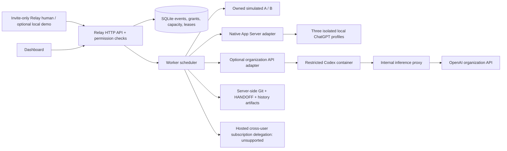

# Relay

Persistent coding conversations with separately owned Codex worker identities, explicit project approval, and durable handoffs. The credential-free demo runs **simulated inference with real Git files and Python tests**. The native macOS adapter runs three official Codex App Servers with isolated local ChatGPT logins. An optional Docker/organization API backend is preserved; hosted cross-user subscription delegation remains disabled.

## Shared access from multiple computers

Invite-only Relay accounts, project roles, protected event streams, source downloads, pause/resume and three-worker handoffs are implemented. The CLI defaults to invite authentication; demo identity selection requires `--auth demo`.

```sh
python3 scripts/manage_accounts.py bootstrap --data ./shared-data --email organizer@example.com --name Organizer
python3 -m relay.server --auth invite --data ./shared-data --public-url http://127.0.0.1:8000 --allow-http-local
```

This HTTP exception is loopback-only. Real computers connect through HTTPS as described in [MULTI_COMPUTER.md](docs/MULTI_COMPUTER.md), which includes exact deployment configuration, invitations, roles, repository import and the three-device checklist. [MULTI_COMPUTER_STATUS.md](docs/MULTI_COMPUTER_STATUS.md) records the actual test evidence. Five isolated Chrome contexts passed the three-human fallback on one host, including unauthorized-account denial and restart persistence; inference was explicitly simulated. **Physical multi-host access and live shared organization API execution are NOT VERIFIED here.**

Shared mode uses organization-authorized API workers and disables local native subscriptions. Three human accounts, three execution workers and three consumer subscriptions are separate concepts; inviting teammates does not authorize spending another person's subscription. Existing native local-owner proof and data are preserved.

## Start the explicit local demo

Requires Python 3.10+, Git, and macOS/Linux. The local demo has no package installation or API credential requirement.

```sh
python3 -m relay.server --auth demo
```

Open **http://127.0.0.1:8000**. Alex, Sam and Jordan are seeded **local demo identities**, not authenticated production accounts. The server binds to loopback. Do not expose demo login remotely.

```sh
# Separate demo instance: change BOTH the data directory and port.
python3 -m relay.server --auth demo --data ./data-other --port 8001
# Repeatable command-line demo with fresh temporary state:
python3 scripts/demo.py
# Or preserve demo state for inspection (do not share with a running server):
python3 scripts/demo.py --data ./demo-recording
```

If startup reports an existing server, open the URL shown or press Ctrl+C in its original terminal before restarting. **Do not delete a live `server.lock`.** A leftover lock file after shutdown is harmless. Existing data migrates automatically without replacing conversation IDs, transcripts or custom worker names. Stop any old Relay process before starting this version against the same data directory.

`RELAY_DATA_DIR` changes the default storage path. `.env.example` contains placeholders. Load a locally configured file explicitly with `--env-file .env`; Relay does not auto-load it. Existing shell exports take precedence. State under `data/` is ignored by Git. Use a different directory to start fresh.

## Exact hackathon demo

1. Launch with a fresh directory: `python3 -m relay.server --auth demo --data ./demo-session --port 8001`; open http://127.0.0.1:8001 as Alex.
2. Select **Password toolkit**. Worker A belongs to Alex; B belongs to Sam. Both have explicitly seeded project approval, opt-in, and independently labeled **simulated** capacity.
3. Submit the prefilled “Add a password-strength validator and tests to this sample project.” prompt on Worker A. A writes the actual `validator.py` and waits at a safe boundary. Inspect its attributed events and files.
4. Click **Simulate Usage Limit**. A becomes quota-blocked **in the simulation only**. Relay stops writes, creates a Git checkpoint and context, then assigns approved Worker B.
5. Open the handoff timeline, **HANDOFF.md**, **Working context**, **Checkpoints**, and file diff. The handoff records reason, authorizer, source/target, context version and Git commit. The Relay conversation ID remains unchanged.
6. B reads the unfinished objective/current state/test information, writes tests, and executes five real unittest checks. Completion appears only after the actual result.
7. Refresh, stop/restart the backend, and reselect the project. Transcript, context, assignments, checkpoints and code persist.

The **Run handoff demo** button performs steps 3–6 as one operation on a fresh demo project. To repeat after a simulated limit, Alex can manually mark A available in owner settings; this is explicitly simulated capacity management. `scripts/demo.py` resets only the designated demo workers and is repeatable on its own data directory. Never run the CLI demo concurrently against a server's directory.

For approval behavior, create a new project. Membership alone does not make A/B eligible: each owner/admin must explicitly grant that project in worker settings. For no-capacity behavior, set B offline as Sam before step 4; the task remains `handoff_pending`. Restore B and use **Switch Worker**. To show revocation, opt out an active worker: Relay requests safe stop and selects an approved alternate, or retains pending work.

## Native Codex with ChatGPT authentication

On macOS, install the official Codex CLI, then initialize and authenticate three separate profiles with different accounts you control:

```sh
python3 scripts/native_profiles.py init
CODEX_HOME="$PWD/.relay-native/profiles/a" codex -c 'cli_auth_credentials_store="file"' login --device-auth
CODEX_HOME="$PWD/.relay-native/profiles/b" codex -c 'cli_auth_credentials_store="file"' login --device-auth
CODEX_HOME="$PWD/.relay-native/profiles/c" codex -c 'cli_auth_credentials_store="file"' login --device-auth
python3 scripts/live_smoke.py --backend native --check
python3 scripts/live_smoke.py --backend native --run-live --data ./live-proof
```

Native execution needs no Docker, organization API key, proxy or required model setting. Each App Server owns its profile and private workspaces. Authentication stays with the CLI; never copy auth files or put credentials in Relay. The smoke requests genuine A → B → C coding work, two Git-checkpointed handoffs, new threads per profile, successful test output and restart persistence. It marks success only after all checks pass. **Real native A → B → C execution was verified on 2026-10-24 with three distinct authenticated accounts, two checkpointed handoffs and seven passing generated tests.** Mocked RPC integration and real CLI protocol/sandbox checks are reported separately in [LIVE_CODEX_STATUS.md](docs/LIVE_CODEX_STATUS.md).

Launch the native dashboard with a real pinned local-owner account; demo identity switching cannot authorize native execution:

```sh
python3 scripts/manage_accounts.py bootstrap --local-owner --data ./local-native-data --email owner@example.com --name 'Local Owner'
python3 -m relay.server --auth local-owner --backend native --data ./local-native-data --public-url http://127.0.0.1:8000
```

Sign in as that owner and select A/B/C in the **NATIVE LOCAL profiles** panel. [LOCAL_NATIVE_DASHBOARD.md](docs/LOCAL_NATIVE_DASHBOARD.md) has per-profile checks, exact setup, the ownership guard and the genuine browser A → B proof. Native execution is rejected in demo and shared/invite dashboards. Existing profile logins are used without copying credentials or automating Codex login. Choose a native worker explicitly, enter any coding objective and optionally pause after the first phase. Select another native worker and use **Switch Worker** to continue. The same Relay conversation retains files, visible history and pending steps; each account gets a fresh Codex thread. Only the configured owner can initiate their subscriptions. Usage limits do not automatically rotate accounts.

See [deploy/README.md](deploy/README.md) for exact setup, isolation, recovery, optional custom objectives and the preserved **Docker/API** path. The latter uses `--backend docker-api` and still requires authorized organization funding/configuration. Live execution never falls back to simulation.

## Architecture



A **Relay user** is a human account; a **worker owner** controls eligibility; a **worker** is an isolated logical execution session; an **execution credential reference** is server-only. User membership and worker project grants are separate. The administrator has an explicit organization role. The seed workers have explicit demo approvals; new workers start with only their configured grants.

| Area | Files |
| --- | --- |
| Data, migrations, permissions and scheduling | `relay/store.py`, `relay/migrations.py` |
| HTTP, invite accounts and identity boundary | `relay/server.py`, `relay/accounts.py`, `relay/auth.py` |
| Typed adapters and capability checks | `relay/workers.py`, `relay/native.py`, `relay/app_server.py` |
| Git, context artifacts, safe files and redaction | `relay/workspace.py`, `relay/security.py` |
| Dashboard / worker directory / owner settings | `static/index.html`, `app.js`, `style.css` |
| Optional isolated live execution | `deploy/`, [setup instructions](deploy/README.md) |
| Tests and repeatable demo | `tests/`, `scripts/demo.py`, `scripts/check_ui.py` |

Full original visible events are append-only, ordered and paginated. Summaries are separate, versioned, lossy context with event references, not an unbounded active model window. `HANDOFF.md` and per-event historical files remain in the server workspace; a new worker can read older files on demand. Provider native thread IDs are stored on assignments separately from the stable Relay conversation ID. Reasoning items are excluded.

States follow `queued → running → pausing → checkpointed → handoff_pending → running → completed/failed`, with terminal cancellation. A mutex, transactional assignment, workspace lease, one active task per conversation, generation checks, and request idempotency prevent duplicate writers. Real execution runs in a background thread; a handoff/cancel waits for native interruption or container shutdown before checkpointing and reassigning. Simulation deliberately waits at a safe boundary after implementation for the demo.

## Execution modes and configuration

| Mode | Behavior |
| --- | --- |
| **Simulation** | Fully runnable default, no credentials, deterministic validator code and actual tests; capacity signals are simulated independently per worker |
| **Native Codex** | macOS App Server stdio; isolated `CODEX_HOME` ChatGPT logins and workspaces, owner-initiated tasks and explicit same-owner handoffs; no Docker/API key required |
| **Organization API** | Docker-only adapter using documented `codex exec --json`; API funding/quota shared by organization. Requires explicitly configured server secrets, reviewed container image, internal network/proxy, model, owner/admin approval and opt-in |
| **Personal subscription** | **Unsupported** for Relay's remotely hosted cross-user delegation use case; enrollment is visible but execution fails closed with `unsupported_execution_mode` |

Native execution and optional Docker/API execution have separate mocked protocol tests. **Native real model execution and A → B → C continuation passed**, including seven generated tests and restart persistence. The optional Docker/API model path remains unverified. Follow [deploy/README.md](deploy/README.md) for the concrete setup and live acceptance procedure. Adding a raw key to the frontend or copying a CLI auth directory is never supported. Worker switches do not reset shared API limits. Unknown remaining quota and reset times remain unknown.

See [AUTH_EXECUTION_COMPATIBILITY.md](docs/AUTH_EXECUTION_COMPATIBILITY.md) for official documentation reviewed and the difference between local owner-initiated ChatGPT execution and cross-user subscription delegation, and [IMPLEMENTATION_STATUS.md](docs/IMPLEMENTATION_STATUS.md) for an honest feature inventory.

## HTTP API

Data routes require an authenticated Relay session; mutation bodies are JSON. Shared mode also requires same-origin requests and `X-Relay-CSRF` for authenticated mutations. `/healthz` and `/api/auth/config` reveal only public service status/mode. Worker enrollment/settings never accept raw keys, tokens, cookies, auth directories or credential references.

| Method | Route | Purpose |
| --- | --- | --- |
| POST | `/api/login` | Shared mode uses Relay email/password; explicit demo mode alone accepts seeded `user_id` |
| GET | `/api/overview` | User/org/project/worker directory, explicit auth/execution modes |
| GET | `/api/workers?project_id=ID&mine=1` | Authorized directory, project eligibility, ownership/capacity, optional own workers |
| POST | `/api/workers/enroll` | `display_name`, `owner_type`, `execution_mode`, `project_ids`, `opt_in`, max parallel tasks (1) |
| POST | `/api/workers/configure` | Owner/admin changes `worker_id`, name, opt-in, availability or project grants |
| POST | `/api/workers/revoke` | Owner/admin revokes a project grant or all opt-in eligibility |
| POST | `/api/availability` | Compatibility route for owner/admin availability changes |
| POST / GET | `/api/projects` / `/api/projects/:id` | Create project; inspect its ongoing conversation/tasks/files/contexts/handoffs/checkpoints/assignments |
| GET | `/api/conversations/:id/events?after=0&limit=100` | Ordered transcript pages; `next_after` cursor, max 100 |
| GET | `/api/tasks/:id/result` | Project-authorized execution runs, native IDs, exit codes, timings and progress |
| GET | `/api/artifacts/:id` | Authorized large event content |
| POST | `/api/prompt` | `{conversation_id,prompt,worker_id?,execution_mode?,pause_after_turn?}` saves task; queues if no approved worker is available |
| POST | `/api/switch` | `{task_id,generation,target_worker_id?,reason_code?}`; manual_switch/task_pause/retry |
| POST | `/api/limit` | `{task_id,generation}` simulated limit, only valid on simulated tasks |
| POST | `/api/continue`, `/api/cancel` | Finish at the current simulation boundary or request safe cancellation |
| POST | `/api/demo` | `{project_id}` runs the designated A→B simulated handoff flow |
| POST | `/api/membership` | Admin explicitly grants a user's project membership; never grants worker access implicitly |

Approved native and organization API tasks can be saved queued while their runtime is unavailable; an explicit `execution_mode: native` or `organization_api` preserves that intent. Simulation still accepts only the validator fixture.

Mutations accept `request_id` for retries. Reusing a key with different input is rejected. Directory responses omit even credential references. Hidden/unshared workers are not automatically listed to colleagues. Seed private sandbox belongs only to Sam; explicit administrators can inspect organization projects.

## Verification

```sh
python3 -m unittest discover -s tests -v
python3 scripts/demo.py
python3 scripts/check_ui.py
python3 -m compileall -q relay tests scripts deploy
```

Optional development checks (no production dependency):

```sh
python3 -m pip install -r requirements-dev.txt
python3 -m ruff check .
python3 -m mypy relay/workers.py relay/auth.py relay/codex_events.py relay/native.py relay/app_server.py
```

There is no framework build step. UI checking validates HTML IDs and uses Node or macOS JavaScriptCore for syntax. The shared fallback was tested in real isolated Chrome contexts; this does not verify physical multi-host or live organization execution. Tests cover real process restart, migration preservation, project/grant privacy, worker ownership, credential rejection/redaction, unsupported personal mode, real fixture tests, idempotency/concurrent handoffs, async safe stop, shared-capacity provenance, checkpoint failure and unverified-container cleanup. Controlled live-mode fixtures never call a paid provider.

## Recovery and security limits

Keep one server per data directory; the process lock protects HTTP startup. Do not operate directly on its database/worktree from another process. A restart never automatically replays an uncertain model/tool action. Interrupted tasks become pending. If Docker cleanup cannot be verified, Relay retains the writer lease and pausing state: restore Docker, verify/stop the task-labeled container, and restart Relay before requesting another worker.

Git and SQLite cannot commit atomically. If a checkpoint fails, files and the error remain; inspect the worktree before explicit retry. The application never resets a repository to discard partial work. Checkpoint diffs are the reviewable output; remote PR creation is not implemented.

Simulation executes only trusted fixture code with a bounded test command. Native coding uses the verified macOS permission profile and private Git clones; tools cannot read credential homes or other workers, and uncertain changes are retained privately. The optional Docker/API backend uses a non-root container, limited CPU/memory/processes/deadline, read-only host metadata, no host home/auth/socket, and internal-only networking through the narrow API proxy. The organization key remains outside generated code; a bounded inference capability is available to the coding container. Only trusted operators may control Docker or the data volume. Add filesystem quotas to the volume for deployed workloads.

The application supports one trusted organization per invite-only HTTPS deployment. Demo identity selection remains loopback-only. Established SSO/OIDC, MFA, account recovery, backups/retention and external security review remain future work; see the shared deployment guide. Exact configured secrets/common key patterns are filtered, but no detector can identify every arbitrary secret: never paste credentials into prompts or repositories. Event triggers prevent application updates/deletes, not tampering by a database administrator.
